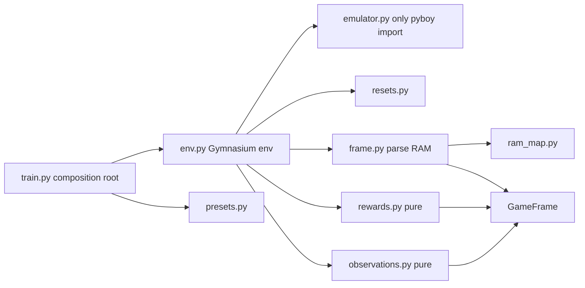

# PokemonRedExperiments: findings and architecture for a rebuild

> Some claims here were later corrected; see `docs/CONFLICT_RESOLUTIONS.md`.

Investigation of [PWhiddy/PokemonRedExperiments](https://github.com/PWhiddy/PokemonRedExperiments) (commit `5fa47ef`, 2026-09-11), its follow-up work, and what to change in a rebuild. Companion to `STARTING_POINT.md` (what to build first) and `RAM_MAP_REPORT.md` (memory addresses), both written by other sessions. This report does not repeat their content.

## Summary

1. **Rebuild the environment; don't fork it.** Upstream's value is its data files and its lessons. Its code is one 587-line class doing emulation, reward, observation, logging and video, and the repo already holds four variants of that class.
2. **The biggest measurable speedup is probably not the emulator.** PyBoy's `fast_mode` is 2.85x faster, but a measured PPO run (another session, about 1,000 steps/s) spends about 80% of its time outside the emulator. By arithmetic, `fast_mode` alone gives only about 14%. Profile and fix that overhead first.
3. **Expect a long horizon problem, not a tuning problem.** With γ = 0.997, a badge 3,000 steps away is worth 0.0006 today. Published progress past Cerulean came from extra machinery: memory, save-state sharing, and game-specific rewards and scripts.
4. **The strongest idea for improving performance is the emulator's restore ability.** Save takes about 10 ms and restore about 3 ms, and restored runs replay exactly. The project that beat the game says its training did not improve until it shared states this way.
5. **Upstream has four defects worth not copying.** A "stuck" penalty that refunds itself, reversed event names, a default upload to a public server, and a checkpoint name that understates training by roughly 60x (estimate).
6. **Architecture: one pure core and one pattern where variation is proven.** Reward terms and start-state selection vary, so they get seams. The emulator has one backend, so it gets a plain module rather than a plugin interface.

**Limits of this investigation:**

- I did not run upstream's code. The permission system blocked it, so upstream behavior below comes from reading the source, or from my own scripts reproducing a specific calculation.
- I did not evaluate the pretrained checkpoint, because that requires a policy and environment able to run it. I only read its metadata and weight shapes.
- No training was run.

**Evidence tags:** `[ran]` my own script on your ROM. `[read]` read in source. `[paper]` Pleines et al. `[docs]` read through a summarizing fetch. `[other session]` from `STARTING_POINT.md`, not reproduced. `[inference]` my reasoning, not directly measured.

---

## 1. What upstream is

| Version | Files | Exploration signal | Observation | Status |
|---|---|---|---|---|
| `baselines/` (2023) | `red_gym_env.py`, 625 lines | Frame similarity via KNN index | Single image with reward bars drawn in | Old PyBoy API; `baseline_fast_minimal.py:12` imports a module that doesn't exist |
| `baselines/ray_exp/` | `red_gym_env_ray.py`, 513 lines | Env not read in detail | Env not read in detail | RLlib experiment |
| `v2/` (2024-25) | `red_gym_env_v2.py`, 587 lines | Count of unique `(x, y, map)` | Dict: screens, visited map, events, party summary | **Current. Read this one.** |
| `jippity-6-test/` (2026) | Play scripts | None | Screen only | LLM play test on a romhack, not RL |

### v2 configuration `[read]`

| Item | Value |
|---|---|
| Algorithm | SB3 PPO, `MultiInputPolicy`, confirmed against the checkpoint's metadata |
| Network | 1,103,176 unique parameters. Two Nature CNNs (screen and map, 256 features each), concatenated with flat inputs (3,038 total), then 64x64 policy and value MLPs |
| Batch | 64 envs × 2,560 steps = 163,840; minibatch 512; 1 epoch; **320 gradient steps per iteration** |
| PPO | lr 3e-4, γ 0.997, λ 0.95, clip 0.2, entropy 0.01, no value clipping, no LSTM |
| Episode | Fixed 163,840 steps, about 18.3 hours of game time, ended as `truncated` |
| Start | `init.state`: bedroom, no party, no flags `[ran]` |
| Actions | 7 buttons; hold 8 frames in a 24-frame decision |

Checkpoint weight files show 2,513,864 parameters, but that total counts the feature extractor three times.

### v2 reward `[read]`

Each step pays the change in a running total. With `reward_scale=0.5` and `explore_weight=0.25`:

| Term | Pays | Worth in unique tiles |
|---|---|---|
| New tile | 0.0125 | 1 |
| Event flag | 2.0 | 160 |
| Badge | 5.0 | 400 |
| Heal | 5 × (fraction healed)² | Full heal = 400 |
| Stuck | See defect D1 | |

The level reward is commented out. A 2025 commit says this followed Marco Pleines's experiments.

### The repo is not the paper's configuration

Don't expect this repo to reproduce the paper's tables, or the reverse.

| | Repo v2 `[read]` | Paper `[paper]` |
|---|---|---|
| Workers × steps | 64 × 2,560 | 32 × 2,048 |
| Epochs / minibatches | 1 / 320 | 3 / 8 |
| Gradient steps per iteration | 320 | 24 |
| Entropy coefficient | 0.01 | None (tuning showed no benefit) |
| Value clipping / optimizer | No / Adam | Yes / AdamW |
| New-tile reward | 0.0125 | 0.005 |
| Heal | Squared fraction | Linear × 2.5 |
| Level reward | Off | On for baseline |
| Episode | Fixed 163,840 | 10,240 + 2,048 per event |
| Start | Bedroom | After Oak's Parcel, Squirtle |

---

## 2. Defects and traps found in upstream

| ID | Finding | Evidence | Consequence | Do this instead |
|---|---|---|---|---|
| D1 | **The stuck penalty refunds itself.** It sits in a total whose changes are paid, so it pays −0.025 once on crossing 600 visits, 0 while staying, and +0.025 for leaving. | `v2/red_gym_env_v2.py:355`, `:394`, `:525` `[read]`; arithmetic rerun | The intended per-step pressure doesn't exist. Small in magnitude, but the agent is never penalized for staying | Make each term return that step's reward directly |
| D2 | **Event names are bit-reversed.** Names are looked up with `f"{val:08b}"` (highest bit first), while `events.json` numbers bits lowest first. | `:236-241` `[read]`; on `has_pokedex.state`, correct order gives "Followed Oak Into Lab", "Oak Asked To Choose Mon"; upstream order gives "Got Pokeballs From Oak" and others `[ran]` | Logging only, not reward. This likely explains the source's `TODO this currently seems to be broken!` | Unit-test names against a known state |
| D3 | **Streams to a public server by default.** `StreamWrapper` opens a websocket to `wss://transdimensional.xyz/broadcast` and sends coordinates and metadata every 300 steps, blocking the env while it does. | `v2/baseline_fast_v2.py:22`, `v2/stream_agent_wrapper.py:14` `[read]` | Unexpected outbound data, plus one connection per env | Off by default; opt-in only |
| D4 | **The checkpoint name understates training.** `poke_26214400.zip` records `num_timesteps=26,214,400` but `_n_updates=10,107`. At 163,840 samples per update, that is about **1.66 billion steps**. `learn()` resets the step counter by default, and `go_forever.sh` restarts training repeatedly. | Checkpoint metadata, SB3 `base_class.py:411` `[read]`; total is `[inference]` and assumes the batch size stayed constant | Don't budget from "26M". It would understate the work by about 63x | Store cumulative steps in your own checkpoint; never restart counters |
| D5 | **Per-step stats are never trimmed and are shipped whole.** `agent_stats` gets one dict per step, and the logging callback fetches every env's full list at episode end. | `:267`, `v2/tensorboard_callback.py:43` `[read]`; about 15 MB per env per episode pickled, about 1 GB across 64 envs, from representative rows `[ran]` | A memory and IPC spike each episode. The real figure is likely higher, since identical test rows pickle unusually small | Keep fixed-size episode summaries in `info` |
| D6 | **All envs reset together.** Fixed episode length means all 64 restart at once. | `[read]`; named by `[paper]` §IV-B2 as a catastrophic-forgetting risk | Every rollout in a stretch shows the same part of the game | Stagger resets or use a step budget |
| D7 | **`init.state` is an old-format save.** It loads on PyBoy 2.9 (142,586 bytes vs 178,108 for a current save), but the first load in a new emulator differs from later loads, first at step 983, in 172 of 1,500 steps. Re-saving it once in the current format removes the difference. | `[ran]` | Results depend on whether an emulator is fresh, which silently breaks exact replay | Convert each state once and commit the result |
| D8 | **The seed doesn't affect the game.** `reset(seed=...)` only stores the value. Every episode starts from the same state, and randomness comes only from action sampling. | `:123-124` `[read]` | Deterministic evaluation repeats one episode | Evaluate with sampled actions, or randomize the first few presses as `[paper]` §II-E suggests |
| D9 | **Docs disagree with code.** The README says it reaches Cerulean; a commit says it can reach SS Anne. The flag range stops at `0xD87E` (311 bytes) while `events.json` covers through `0xD886` (320 bytes), and bits `0xD863-0` and `0xD867-7` have no name. | `[read]`, `[ran]` | Claims can't be relied on; event counts may differ between implementations | Choose one range and record it |

**Checked and found correct:** SB3 bootstraps the time limit correctly when an env returns `truncated` (`on_policy_algorithm.py:240`, `subproc_vec_env.py:38`). This was a plausible bug, but it is not one. SB3 2.9.2 also stores observations in their native types, not float32, so the rollout buffer isn't wasteful there.

---

## 3. Measurements on your machine

**Setup:** M4 Pro (10 performance + 4 efficiency cores, 24 GB), Python 3.12, PyBoy 2.9.0, torch 2.15.0, your ROM (SHA-1 matches upstream's). Scripts are in a temporary session folder that no longer exists, a temporary folder. Tell me if you want them moved into the project.

**Contention warning:** other Claude shells were running, and load averages reached 11-15 (one reading: 3.5 before the run, 11 after). Treat throughput as lower bounds and the differences at 10+ processes as noise. Ratios between modes at one process are the most reliable.

### Emulator throughput `[ran]`

Random actions at 24 frames per step, emulator only.

| Mode | 1 process, two runs | 8 processes | 14 processes |
|---|---|---|---|
| Default | 486 / 502 steps/s | not run | not run |
| Sound off | 512 / 526 | 4,059 / 4,054 | 5,493 / 4,811 |
| **`fast_mode=True`** | **1,406 / 1,431** | **10,782 / 10,995** | **14,974 / 15,887** |

- `fast_mode` is about 2.85x faster than default. Sound off alone gains about 5%.
- Scaling is near-linear to 8 processes. Beyond that the runs are too noisy to call.
- For context, the paper reports about 392 steps/s per process on a Ryzen 7 2700X `[paper]`.

### Is `fast_mode` safe? Mostly, but unproven late in the game `[ran]`

Replaying a recorded 20,000-step walk from `has_pokedex_nballs.state`:

- WRAM stayed identical to accurate mode at every comparison (every 10 steps).
- Position agreed on every step.
- 317 battle steps occurred, and the walk visited maps 0, 12, 37, 38 and 40.
- **11 of 2,000 sampled screens differed**, by about 0.4% of pixels, but those pixels changed strongly. A separate 1,500-step random run from the bedroom had 3.5% of screens differ.

**Conclusion:** game logic matched on everything tested, but this covers only Pallet Town, Route 1 and a few battles. Pixels do differ, so the policy sees slightly different inputs. Before relying on `fast_mode`, repeat this test on a real policy's trajectories through gyms, trainers and menus. Train and evaluate in the same mode, or measure the gap between them.

### Save states `[ran]`

| | |
|---|---|
| Save | 9.75 ms |
| Load | 3.30 ms |
| Size | 178,108 bytes; 9,329 bytes with fast zlib |
| Restore, then replay 1,000 steps, same emulator (twice) | Identical to the uninterrupted run |
| Restore into a different emulator | Identical |

Determinism is exact once D7 is handled, and small input changes matter: one changed action at step 100 changed memory on that step, and most later steps differed. The paper describes the same property.

An archive of 10,000 compressed states is about 93 MB, so memory isn't a constraint.

### Python overhead `[ran]`

| Operation | Cost per step |
|---|---|
| Emulator, default | About 2 ms |
| Emulator, `fast_mode` | About 0.7 ms |
| Flag bits via per-byte f-string (upstream's pattern) | 0.129 ms |
| Event popcount via `bin().count` (upstream's pattern) | 0.024 ms |
| Both of those via NumPy | 0.009 ms |
| Downscale with `skimage` | 0.085 ms |
| Downscale with NumPy | 0.012 ms |

Rewriting these saves about 0.2 ms. That is minor in default mode, but about a quarter of the step in `fast_mode`. Do it, since it costs little, but it isn't the main bottleneck.

### Network, same size as upstream `[ran]`

| Device | Inference, 14 obs | Inference, 64 obs | Training, minibatch 8,192 |
|---|---|---|---|
| CPU (10 threads) | 1.45 ms | 57.6 ms | 8,103 ms |
| MPS | 0.94 ms | 1.00 ms | 225 ms |

MPS trains at about 36,000 samples/s, which is 36x the CPU rate. Timings exclude tensor conversion and copying from the rollout buffer.

### Where the time goes `[inference]`

`STARTING_POINT.md` measured full SB3 PPO with 10 envs on MPS at **about 1,000 steps/s** `[other session]`, while 10 emulators alone reach about 5,000. Per sample:

| Component | ms per sample | Source |
|---|---|---|
| Emulator, 10 processes | 0.20 | Measured |
| Training (paper's 3 epochs) | About 0.08 | Calculated from MPS rate |
| Inference | About 0.10 | Measured, for a batch of 10-14 |
| **Everything else** | **About 0.6** | Unexplained remainder |

Under these numbers, `fast_mode` alone gives about 14% (0.20 → 0.08 ms), not 2.85x. Likely causes of the remainder are pickling dict observations over pipes, synchronous stepping, and SB3's per-step Python and device transfers. **This has not been profiled, and the two measurements came from different runs under different load.** Profile it before building on this.

---

## 4. What follow-up work established

### Pleines et al. 2025 ([arXiv 2502.19920](https://arxiv.org/abs/2502.19920v2))

5 seeds, 400M steps, 30 evaluation episodes at each of 25 time points. Roughly 36 hours per run. `STARTING_POINT.md` has the main results table. Added lessons:

| Finding | Evidence (Table II unless noted) | Implication |
|---|---|---|
| Navigation reward is required but fragile | Removed: 0.00 milestones. ×10: 1.04 milestones (Beat Brock 0.04). Baseline: 4.19 | Sweep this weight first; use a pixel-free novelty signal if possible |
| Removing level reward was the best ablation | 4.60 ± 0.7 vs 4.19 ± 0.2, though intervals overlap | Test it; see conflict below |
| Fast text and no animations helps | Steps to Brock 3,753 vs 5,587 | Cheap, large gain |
| GRU helps at memory tasks but is unstable | Bill's quest 0.48 vs 0.11; Cerulean done 0.21 vs 0.00; Brock 0.76 vs 0.99 | Promising, not a free win. Also 24 days on CPU |
| Heal reward gets farmed | Bulbasaur: 399 heals, 0% Cerulean | Log heals per episode; cap or restrict them |
| Discounting favors the immediately rewarded choice | When allowed to choose, agents pick Charmander because it takes fewer button presses, despite being worse against Brock | γ can't connect early choices to distant results |
| Agents waste steps | Human reaches Cerulean in 11,188; agents take about double | Battles and dialogue are where timing is coarse |

### Rubinstein et al. ([docs](https://drubinstein.github.io/pokerl/), [code](https://github.com/drubinstein/pokemonred_puffer)): the furthest result

They report beating the game "with a few caveats", and describe the output as "a technique for producing solutions to Pokémon", not a policy that beats it `[docs]`.

- **Scale:** 4 machines, each with an RTX 4090, i9-14900K and 128 GB; peak 10,000 steps/s; 7 hours to 1 day per run after over a month of sweeps with CARBS `[docs]`. This fills the gap noted in `STARTING_POINT.md`.
- **Swarming:** when an agent completes a required objective, all envs load its save state. Other trigger and population rules were tried and did worse. The authors say the lack of predictable data "plagued us for months" `[docs]`. The code comments call an earlier partial-migration version "really unstable" `[read]`.
- **Simplifications:** `config.yaml` has 11 `auto_*` options, including solving Strength puzzles and using Surf automatically. Infinite money, item tossing and map-ID reward boosts are also used `[read]`. They have not shown a stable run with all scripts disabled `[docs]`.
- **Reward:** over 25 parameters. Reports failure with exploration only, A-press rewards, and no progress rewards `[docs]`.
- **Default PPO config, may not match the winning run** `[read]`: 288 envs on 24 workers, batch 65,536, minibatch 2,048, 3 epochs, lr 2e-4, γ 0.998, clip 0.1, entropy 0.01, BPTT 16, LSTM. CNN stride is 2, with kernel sizes tied to the 8-pixel tile (`multi_convolutional.py:42`), compared to Nature CNN's stride 4.
- **Worth borrowing:** two-bit screens stored 4 to a byte, embeddings for map and item IDs, and "mini-episodes" where tracking resets while the game continues.
- **License:** the repo contains no license file, so use its ideas, but ask the authors before copying code.

### PokeRL (Mudireddy & Patibandla, [arXiv 2604.10812](https://arxiv.org/abs/2604.10812), 2026)

Early-game tasks only. Reports looping episodes falling from 41.2% to 4.7% with anti-loop measures (figures from search summaries, not from reading the paper). Useful if looping shows up; see the caution in `STARTING_POINT.md` about its timing claim.

### Where sources disagree

| Question | Source A | Source B | What I'd do |
|---|---|---|---|
| Level reward | Paper: removing it was the best ablation | Rubinstein: removing it was "a failed experiment" | **Different goals.** The paper stops at Cerulean; Rubinstein plays the whole game. Keep it as a switch and test both |
| Level formula | Rubinstein's docs: `30 + (sum−15)/4` | Rubinstein's code: `15 + (sum−15)/4` | Code is what ran. The docs' version also jumps by 15 at the threshold |
| LSTM size | Docs: 128 units | Code default: 512 | Not settled. Check the winning config before copying |
| Reward for levels | `RAM_MAP_REPORT.md` suggests party level sum | Paper warns it is grindable, and capped it | Use the paper's capped form |
| Simple save-state sharing | Rubinstein: required | Paper: reached Cerulean without it | Probably needed only past Cerulean. Test when you get there |

---

## 5. Why performance stalls: an RL reading

**The core problem is horizon.** With γ = 0.997, the effective horizon is 333 steps. γ³⁰⁰⁰ = 1.2 × 10⁻⁴, so Brock's badge is invisible from 3,000 steps away. Everything that works does so by placing small rewards along the path, which is why reward shaping dominates this project and creates its exploits. The paper tuned γ across {0.99, 0.997, 0.999, 0.9995} and kept 0.997, and Rubinstein's sweep landed near 0.998, so raising γ isn't a free fix.

**Exploration is the problem with known theory.** A random policy needs exponentially many episodes to complete a long specific sequence. With restores to visited states, the cost falls to about H(A+1)/2 steps on a combination lock (`robot-learning-expert`, `concepts/resets-and-exploration.md`). Game emulators are exactly the "local simulator" setting. Throwing that away is a choice, and the Go-Explore line of work, including swarming, is what exploits it.

**The reward isn't Markov in the screen.** "New tile" depends on history, so without the visited map the critic can't predict it. That is why the visited-map observation matters, and Rubinstein reports agents kept revisiting areas without it. Any replacement bonus has to give the critic matching information.

**Evaluate carefully.** Total return changes whenever the reward does, so it can't compare experiments. The paper's large standard deviations also make differences easy to overread (GRU 3.93 ± 2.2). The skill's guidance is 5-10 seeds for a claim, with IQM, stratified bootstrap intervals and probability of improvement (`run_stats.py`).

---

## 6. Improvements to test, in order

Each changes one thing against the rebuilt baseline, and the primary metric is **milestone completion from a fixed start at a fixed step budget, using sampled actions**. Report IQM across seeds. Time per seed depends on rows 1-2.

| # | Change | Why it should help | Evidence | Effort | Primary risk |
|---|---|---|---|---|---|
| 1 | **Profile and fix the rollout pipeline:** shared-memory observations, several envs per worker, packed storage | About 60% of per-sample time is unexplained | `[inference]` from §3 | Medium | Requires leaving plain `SubprocVecEnv` |
| 2 | **`fast_mode` + NumPy observations** | 2.85x emulator speed | `[ran]` | Low | Pixel differences; late-game fidelity untested |
| 3 | **Fast text, no battle animations** in the start state | 33% fewer steps to Brock | `[paper]` | Low | Screen timing changes; both this and row 2 alter timing, so test separately |
| 4 | **Staggered resets:** step budget (paper), then mini-episodes (Rubinstein) | Prevents all envs restarting together | `[paper]` qualitative | Low | Paper notes instability persists |
| 5 | **Restore-based curriculum:** archive of states by required-events set, restarting from the frontier | Addresses exploration directly | `[docs]`, skill theory, `[ran]` cost | Medium | Forgets early game; the result is a technique, not a policy that plays from the start. **Always also evaluate from the start state** |
| 6 | **Mixed start distribution** (mostly frontier, some earlier) vs full migration | Could reduce forgetting | `[inference]` only. Rubinstein found partial migration worse, so low prior | Low after 5 | May just reproduce their negative result |
| 7 | **GRU/LSTM** with BPTT about 16 | Memory tasks, Bill's quest | `[paper]`, `[docs]` | Medium | Instability; measure on MPS |
| 8 | **Tile-aligned CNN** (kernel 8, stride 2 or similar) | Game is built on 8-pixel tiles | Used by Rubinstein, no ablation found | Low | More parameters and compute |
| 9 | **Compact state inputs:** map-ID embedding, facing, battle type, required events only | 2,488 flags are mostly noise for now | `[docs]` | Low | Authors doubt some of these helped. Add them one at a time |
| 10 | **Better novelty:** lifelong count bonus (1/√N), decay; then RND | Reduces sensitivity to navigation weight | `[paper]` proposal, not tested for this game | Medium | Random-screen effects: Game Corner style traps. Separate intrinsic value head `[inference]` |
| 11 | **PPO update shape:** repo's 320 small steps vs paper's 24 large | Untested head to head | Config differences in §1 | Low | Low. Watch KL and clip fraction |
| 12 | **Time as an action / options** | Attacks horizon and step waste directly | `[paper]` proposal | High | Research-level. Only after the above |

**Don't start with:** a larger network (the winning policy is about 5M parameters), hyperparameter sweeps before the pipeline is settled, or LLM-based approaches, which are a different project.

**Cost on your Mac:** at about 4M steps/h `[other session]`, 5 seeds to 100M is about 5 days of sequential running. Items 1-2 could shrink that a lot, but by how much is unmeasured. Cloud compute is possible later, and a Runpod integration is already available in this environment.

---

## 7. Architecture

### Is a pattern warranted? One decision per axis

| Axis | Has it varied? | Decision | What gets cheaper | What gets harder |
|---|---|---|---|---|
| **Reward terms** | Yes. Upstream has 4 env copies; Rubinstein has 8 reward classes, repeating about 20 dict entries each | **A list of `RewardTerm` objects + a plain dict of presets** | A new term is one class and one preset line; no env edit. Per-term logging is automatic | Reading full reward logic spans 2 files |
| **Start state / resets** | Yes. Fixed state, step budget, swarm are 3 known variants | **Strategy:** one `ResetPolicy` callable passed to the env | Swapping to an archive changes no env code | One more file to open when tracing resets |
| **Observation + network** | Yes, and they must match | **Factory:** a named preset returns encoder and network together | Mismatched pairs become impossible | Free mixing needs a new preset |
| **Game parsing** | Doesn't vary, but is the source of bugs | **Functional core:** RAM → frozen `GameFrame`, then pure functions | Reward tests need no emulator, no ROM | One parsing step per decision |
| **Emulator** | **No.** Only PyBoy, though its API did change (`get_memory_value` → `memory`) | **One plain module, no interface.** Only `emulator.py` imports `pyboy` | A PyBoy API change touches one file | Second backend would need extraction. That's fine; it's 1 file |
| **Trainer** | SB3 now; may change | **No abstraction.** Gymnasium is already the seam | Swapping trainers doesn't touch the env | Each trainer has its own script |
| **Scripted assists** | Not needed yet; Rubinstein has 11 `auto_*` flags | **Don't build.** When needed: a list of assist functions, not flags | Avoids unused machinery | |

**Rejected:** a decorator-based registry (all variants live in one repo, so a dict does it), a DI container (hand wiring in `main` is 20 lines), an event bus for logging (one consumer; `info` dict suffices), a plugin Protocol for emulators (one backend).

**Evidence for the seams:** the design-smell scanner flags upstream's `RedGymEnv` as a god class with 38 public methods, a 98-line `__init__`, and `step()` nested 5 levels. Rubinstein's 1,980-line `environment.py` gives 18 findings, including 8 long functions. Upstream's D1 and D2 are also the kind of bug that a pure-function test catches immediately.

### Structure



```text
src/pokered/
  types.py          GameFrame, a frozen dataclass; imports nothing else from the project
  frame.py          memory -> GameFrame; wraps ram_map.py
  rewards.py        RewardTerm classes; no pyboy, gymnasium or torch imports
  observations.py   GameFrame + screen -> arrays
  resets.py         ResetPolicy: fixed state, step budget, archive
  emulator.py       Only module importing pyboy: press, read, save, restore
  env.py            Gymnasium env wiring these together
  presets.py        Named reward and observation/network presets
  metrics.py        Milestones and fixed-size episode summary
  evaluate.py       Fixed evaluator, separate from training
train.py            Composition root
tests/
```

**Checkable rule:** `check_layers.py src --inner pokered.rewards --forbid pokered.emulator --forbid-infra` should pass, and only `emulator.py` should import `pyboy`. Add this to CI.

**A note on `ram_map.py`:** it comes from another session and has only been read through its report. Its warnings still shape `frame.py`: sample levels at decision points (trap 5), gate battle data on `D057` (trap 6), and don't treat blackout HP gains as healing (trap 7). Upstream's guard for blackout healing is sound and worth keeping.

### Core sketch

This is an excerpt from a version I ran with asserts, which also included the `NewTile` and `EventGain` terms. It shows a per-step stuck penalty that cannot have D1's refund:

```python
@dataclass(frozen=True, slots=True)
class GameFrame:
    """Parsed snapshot of one decision point. Pure data: no emulator reference."""
    map_id: int
    x: int
    y: int
    in_battle: bool
    event_count: int
    badge_count: int

class RewardTerm(Protocol):
    name: str
    def reset(self, first: GameFrame) -> None: ...
    def __call__(self, prev: GameFrame, cur: GameFrame) -> float: ...

@dataclass(slots=True)
class Stuck:
    """A true per-step penalty: pays every step at or above the limit, never refunds."""
    weight: float
    limit: int = 600
    name: str = "stuck"
    counts: dict[tuple[int, int, int], int] = field(default_factory=dict)

    def reset(self, first: GameFrame) -> None:
        self.counts = {}

    def __call__(self, prev: GameFrame, cur: GameFrame) -> float:
        key = (cur.map_id, cur.x, cur.y)
        self.counts[key] = self.counts.get(key, 0) + 1
        return self.weight if self.counts[key] >= self.limit else 0.0

# Composition root: the one place concrete choices are named.
REWARD_PRESETS: dict[str, Callable[[], list[RewardTerm]]] = {
    "v2_like": lambda: [NewTile(0.0125), EventGain(2.0), Stuck(-0.025)],
}
```

The env returns `sum(by_term.values())` as the reward and puts `by_term` in `info`, so every experiment logs each reward term without further work.

A `Protocol` fits because there are several implementations and no shared base behavior. Its checks are static only, so a missing method fails in mypy or at first call, not at construction.

### Tests that would have caught upstream's bugs

| Test | Catches |
|---|---|
| Stuck term pays on every step past the limit and refunds nothing on leaving | D1 |
| Event names on `has_pokedex.state` include "Got Pokedex" and "Followed Oak Into Lab" | D2 |
| Constructing an env opens no network connection (socket blocked in the test) | D3 |
| Checkpoint round trip keeps cumulative step count | D4 |
| Env memory stays flat over 100k steps | D5 |
| Fresh vs reused emulator replay identical over 2,000 steps | D7 |
| Restore then replay identical to the uninterrupted run | Go-Explore's core assumption |
| Each reward term fires once and only once; blackout pays no heal | Reward exploits |
| GAE matches `rl_math.py` on terminated and truncated cases | Bootstrapping errors |

### Logging from day one

- PPO health: approx KL, clip fraction, explained variance, entropy, gradient norm.
- Per reward term and per milestone, with action frequencies by context (overworld, battle, menu).
- Heals, deaths, and tiles per episode, to catch farming early.
- A short video of a sampled episode at each evaluation, since reward curves can hide looping.

Healthy ranges from the skill are rules of thumb. Calibrate them on a known-good run.

---

## 8. What to reuse from upstream

| Keep (MIT) | Change | Leave behind |
|---|---|---|
| `map_data.json`, `events.json` (read lowest bit first), global-map formula | Rewrite the visited map with bounds checks and no printing | `StreamWrapper` as default |
| 8-frame hold in a 24-frame decision (confirmed in `STARTING_POINT.md`) | Rewrite the reward as per-step terms | Frame KNN exploration (v1), replaced by v2 itself |
| Savestates, **converted once** to the current format | NumPy observation pipeline | `agent_stats` list; video and image saving inside `step()` |
| Coordinate-count exploration and visited-map input as a baseline | | |

---

## 9. Recommended sequence

This extends the build order in `STARTING_POINT.md`, which I agree with: start from the paper's configuration in SB3, not upstream's.

1. **Build the core and tests** from §7. Convert the states.
2. **Profile a real rollout, then fix what the profile shows** (§6 rows 1-2). Do this before long runs, since it scales every later experiment.
3. **Reproduce a paper milestone,** following stages 3-5 of `STARTING_POINT.md`. Don't test any improvement until this works. If it can't reach roughly the published Beat Brock rate, later comparisons mean little.
4. **Run the cheap experiments** (rows 3, 4, 8, 11), with several seeds each.
5. **Then run the expensive ones** (5, 7), when the target moves past Cerulean. Revisit whether to leave SB3 here: a custom CleanRL-style loop becomes justified if recurrent minibatches, shared-memory rollouts and restore-based resets all fight the library. Decide on evidence from step 2.

## 10. Decisions for you

1. **What counts as success?** "Beat Brock more efficiently" and "get as far as possible with any help" lead to different projects. The second makes scripts and swarming acceptable; the first makes them cheating. This is the main choice.
2. **Does the final policy have to play from the start of the game?** Swarming produces a run that progresses, not necessarily a policy that does. My suggestion is to always report both.
3. **Mac only, or cloud too?** At current speed, one 5-seed comparison takes about 5 days. That limits how many experiments you can run.
4. **Should I evaluate the pretrained checkpoint?** It would give a real baseline on your machine, but it requires permission to run upstream's code. Alternatively, it could load in a rebuilt env that matches its observations.

## Sources

- Whidden, [PokemonRedExperiments](https://github.com/PWhiddy/PokemonRedExperiments): `v2/`, `baselines/`, README, checkpoint metadata; MIT license
- Pleines et al., [Pokemon Red via Reinforcement Learning](https://arxiv.org/abs/2502.19920v2) (2025): full PDF read, Tables I-III
- Rubinstein et al., [PokeRL docs](https://drubinstein.github.io/pokerl/): [environment](https://drubinstein.github.io/pokerl/docs/chapter-2/env-setup/), [observations](https://drubinstein.github.io/pokerl/docs/chapter-2/observations/), [rewards](https://drubinstein.github.io/pokerl/docs/chapter-2/rewards/), [policy](https://drubinstein.github.io/pokerl/docs/chapter-2/policy/), [running](https://drubinstein.github.io/pokerl/docs/chapter-3/running/), [swarm](https://drubinstein.github.io/pokerl/docs/chapter-3/swarm/), [results](https://drubinstein.github.io/pokerl/docs/chapter-4/results/), read through a summarizing fetch
- [drubinstein/pokemonred_puffer](https://github.com/drubinstein/pokemonred_puffer) at `e3bd1b1`: `config.yaml`, rewards, policy, swarm code, read directly
- Mudireddy & Patibandla, [PokeRL](https://arxiv.org/abs/2604.10812) (2026): abstract only; figures from search summaries
- [PyBoy releases](https://github.com/Baekalfen/PyBoy/releases) and PyBoy 2.9.0 source; Stable-Baselines3 2.9.2 source
- Skills: `robot-learning-expert` (exploration with resets, diagnostics, evaluation, `batch_math.py`), `design-patterns-expert` (selection guidance, `design_smells.py`)
- `STARTING_POINT.md` and `RAM_MAP_REPORT.md`, from other sessions in this directory
